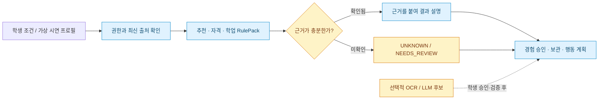
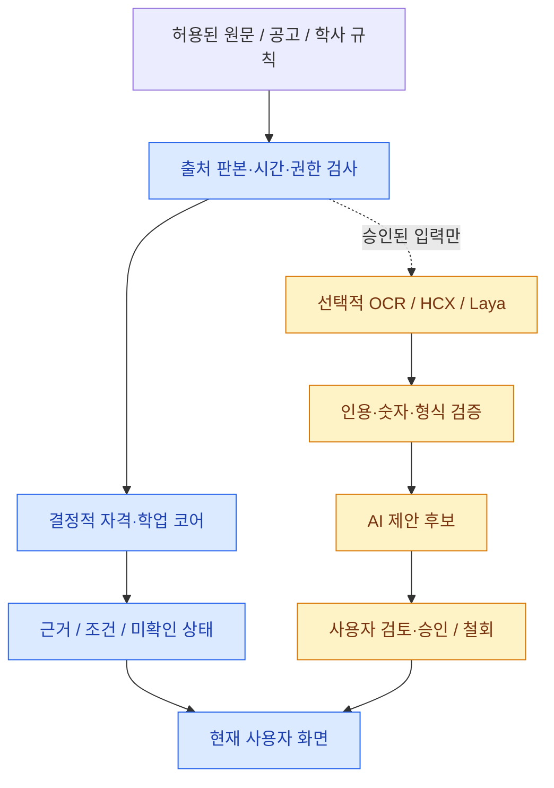

<div align="center">

# 🎓 HUFS One AI

### 학생의 기회, 경험, 학업을 하나의 근거 있는 선택으로

흩어진 **교과·비교과·장학·채용·학사 정보**를 학생의 조건과 연결하고,  
**왜 추천했는지 · 무엇을 확인해야 하는지 · 다음 행동은 무엇인지** 보여 주는 AI 기반 학생 지원 플랫폼입니다.


**한국외국어대학교 학생팀의 독립 프로젝트 · 2026 AI 캠퍼스 바이브코딩 경진대회 관련**

[서비스 소개](#해결하려는-문제) · [주요 기능](#주요-기능) · [시스템 구조](#시스템-구조) · [실행 방법](#실행-방법) · [팀](#팀과-협업)

</div>

> **2026-11-12 현행 재감사:** [36개 PR·31개 이슈 전수 기록](docs/REVIEW_AND_ISSUE_AUDIT_20261112.md). 새로 PR 3개 병합·버그 #427만 완료해 **PR 33건 / Issue 30건 OPEN**(감사 시점). 아래 옛 수치/상태는 기록 당시 스냅샷입니다. 합성 CI는 실 NCP·공식 출처 권리/사람 Gold 인수를 대신하지 않으며 `RELEASE_BLOCKED` 유지.

> [!IMPORTANT]
> **현재 공개 가능한 범위는 합성 데이터 기반 시연 및 자동 검증된 코드입니다.** 실서비스 출시는 `RELEASE_BLOCKED`이며, 학교 공식 인증·졸업 판정·실학생 데이터 사용·실 NCP/AI 유료 호출의 완료를 뜻하지 않습니다. 프로젝트 소유자의 `OWNER_CONFIRMED_APPROVED`와 실제 환경 구성·권리·검증은 별개입니다. [현재 상태](STATUS.md) · [데이터 승인·권리](docs/AUTHORIZATION.md)

> **추가 열린 PR 반영:** 최초 감사 이후 [#483 FAQ 부정어 회귀 보정](https://github.com/ot4562-glitch/HUFS-One-AI/pull/483)이 추가되어 현재 HEAD `4d8b911` 코드 리뷰/CI 7/7 확인·공식 COMMENT 제출(실제 동료 APPROVED·병합 대기). 문서 현행화는 [#484](https://github.com/ot4562-glitch/HUFS-One-AI/pull/484) 리뷰·CI 대기 중입니다. 최신 재조회 결과 **열린 PR 23건·이슈 31건**, 감사 시작 당시 22건과 구분합니다.

## 2026-11-12 이번 회차 기능 구현·리뷰 업데이트

이번 회차 한정 심민성이 기존 팀원 배정과 별개로 `[추가 기능]` 합성 코드를 직접 구현했습니다. **지속적인 담당 변경 규칙은 아닙니다.** [#485 상담기관 검색 필터 경합](https://github.com/ot4562-glitch/HUFS-One-AI/pull/485)은 HEAD `4198d20` 동료 승인·전체 CI 7/7 확인 후 **main [79e8810](https://github.com/ot4562-glitch/HUFS-One-AI/commit/79e8810b49fe7392bf27410b95f3c8596a6e0649)에 실제 병합**됐습니다.

추가 작성한 [#486 공고 검색 만료/쿼터 복구](https://github.com/ot4562-glitch/HUFS-One-AI/pull/486) (합성 회귀 10건 통과), [#487 최대 3개 승인 파견교 비교](https://github.com/ot4562-glitch/HUFS-One-AI/pull/487) (6건 통과), [#488 활동 KST 게시연도·취소](https://github.com/ot4562-glitch/HUFS-One-AI/pull/488) (5건 통과)는 **동료 HEAD 승인·Chrome/Pages 전체 CI 미완으로 미병합**입니다. 브라우저 CI의 GitHub runner 한글 폰트 apt DNS 설치 실패를 제품 코드 통과로 오인하지 않습니다. [#482 WIS 댓글/스크립트 처리](https://github.com/ot4562-glitch/HUFS-One-AI/pull/482)도 리뷰어 반례 수정 후 재승인 대기입니다. 기록은 [현행 STATUS](STATUS.md)에 정리합니다.

## 현행 PR·이슈 전수 검수 — 2026-11-11

- **감사 착수 당시 공개 GitHub OPEN PR 22건·OPEN Issue 31건.** 코드 diff/최신 HEAD/CI·기존 협업자 리뷰와 이슈별 본문·인계 기록을 점검했습니다. [PR·Issue 2026-11-11 전체 감사 원장](docs/REVIEW_AND_ISSUE_AUDIT_20261111.md)에 22개 PR과 31개 열린 이슈를 각각 기록했습니다. 이 숫자는 스냅샷이며 실시간 현황은 [PR 목록](https://github.com/ot4562-glitch/HUFS-One-AI/pulls)과 [Issue 목록](https://github.com/ot4562-glitch/HUFS-One-AI/issues)을 확인하세요.
- 최초 PR 22건 **전부 GitHub 공식 COMMENT 코드 리뷰 등록**. 작성자 본인의 COMMENT를 협업자 APPROVED로 대체하지 않습니다. [#475 API 계약 인벤토리 수정](https://github.com/ot4562-glitch/HUFS-One-AI/pull/475)은 **현재 HEAD 타인 APPROVED + CI 6/6 통과** 확인 후 [main 05d78cd](https://github.com/ot4562-glitch/HUFS-One-AI/commit/05d78cdff03d68d1b711f9009bdbb335bc0e2939)로 실제 병합; 나머지는 종속/인적 승인·검증 대기입니다.
- **정확한 최신 HEAD 협업자 승인 원칙:** 11월 9일의 선택적 리뷰 운영은 이후 [#466](https://github.com/ot4562-glitch/HUFS-One-AI/pull/466)의 11월 11일 강화 지침으로 대체 예정입니다. 신뢰된 main 검증기 [#481](https://github.com/ot4562-glitch/HUFS-One-AI/pull/481)의 실제 승인/병합 전 #466/#476의 독립 gate는 BOOTSTRAP_PENDING으로 차단되며, 체크 우회·자동 병합을 하지 않습니다.
- #431의 주석 속 가짜 시간표 데이터는 [#482](https://github.com/ot4562-glitch/HUFS-One-AI/pull/482) 후속 수정 반영·재검토가 필요합니다. #476 대규모 통합은 **5,100개 canonical rights proof lookahead 한도 버그**를 수정했으나 NCP 실서버/자료·Gold 승인이 아닙니다.
- 기존 본선 전 담당 9개 이슈는 11월 9일 완료·이관 기록을 유지하되, 새로 배정된 **#445 Crawlee/NCP, #447 전 기능 P0, #449 NCP 설계**와 #418/#427 웹 버그 및 #341 FAQ 반례는 OPEN입니다. **31개 열린 이슈를 근거 없이 종료하지 않았으며, RELEASE_BLOCKED는 그대로 유지**합니다.

## 2026-11-09 전수 PR 정리 — 역사적 스냅샷

- 이번 작업의 코드/의존성 15건·리뷰 정책 #425·최종 문서 #419를 합쳐 **실제 병합 17건** (GitHub OPEN PR 0건): 먼저 병합된 #424/#420/#402/#403/#404/#409/#407/#408/#422 **9건**과, 직접 수정 또는 재검토 후 GitHub 병합이 확인된 **#361/#372/#405/#406/#410/#421 6건**입니다. 개별 병합 SHA는 [STATUS](STATUS.md)와 [감사 원장](docs/REVIEW_AND_ISSUE_AUDIT_20261109.md)을 참고하세요.
- **정책 PR [#425](https://github.com/ot4562-glitch/HUFS-One-AI/pull/425)**도 [main `88b7814`](https://github.com/ot4562-glitch/HUFS-One-AI/commit/88b7814a1317bc7856ee04ca83b294f2d9eee465)에 실제 병합되었습니다. 승인 검사용 GitHub Actions 및 그 전용 테스트·CI 참조를 완전히 제거하고 리뷰 기준을 AGENTS/PR_WORKFLOW 문서에 남겼습니다. **마지막 문서 PR [#419](https://github.com/ot4562-glitch/HUFS-One-AI/pull/419)**도 최신 HEAD 일반 CI 11/11 성공 후 [main `fd55ba0`](https://github.com/ot4562-glitch/HUFS-One-AI/commit/fd55ba033b88a44deda159ef8fca4a30f7e84cea)으로 병합 완료했습니다. 이제 [OPEN PR 0건](https://github.com/ot4562-glitch/HUFS-One-AI/pulls)이며 기존 과거 시점의 대기 기록은 역사적 스냅샷입니다. GitHub [실시간 PR 목록](https://github.com/ot4562-glitch/HUFS-One-AI/pulls)을 정본으로 삼습니다.
- `exact-HEAD independent approval`은 코드 오류가 아니라 사람 승인 부재로 실패하던 잡이었습니다. 소유자 지시에 따라 #425에서 관련 자동 워크플로를 삭제하고, 에이전트는 [문서상 리뷰 절차](docs/PR_WORKFLOW.md)를 따릅니다. 이번 한시적 병합 승인과 **실제 타인 APPROVED는 구별**합니다. 소스·계약·CSV/보안·브라우저·DB CI는 유지합니다.
- **코드 감사 1차 활성 이슈 #427/#429/#430/#433 4건**을 포함한 2026-11-09 기준 열린 이슈는 **32건**(변경 금지 역할 5건 포함)입니다. [최신 상태](STATUS.md)·[코드 감사 원장](docs/REVIEW_AND_ISSUE_AUDIT_20261109.md). 실제 출처 권리·NCP/HCX·사람 인수 미완으로 **`RELEASE_BLOCKED` 유지**.


*아키텍처 이미지는 저장소 구현을 이해하기 쉽게 정리한 논리도입니다. 배포 완료 화면이나 실제 운영망을 뜻하지 않습니다.*

## 해결하려는 문제

대학생은 같은 정보도 **학과·학년·이수 현황·관심사·지원 자격·마감일**에 따라 다르게 판단해야 합니다. 하지만 학교 공지, 장학·비교과·채용 공고, 학점과 개인 경험은 서로 다른 곳에 흩어져 있습니다.

HUFS One AI는 학생이 직접 확인해야 할 근거를 연결합니다.

1. **찾기** — 내 조건에 관련 있는 공고와 학사 정보를 모읍니다.
2. **판단하기** — 자격 충족 여부, 근거와 시점, 미확인 항목을 분리합니다.
3. **계획하기** — 경험·학업·지원 준비를 다음 행동으로 이어 갑니다.

추천 점수는 합격 확률이 아니며, 지원 자격과 공식 졸업요건을 AI가 임의로 확정하지 않습니다.

## 주요 기능

| 기능 | 학생에게 보이는 가치 | 현재 구현 경계 |
|---|---|---|
| **맞춤 기회 탐색** | 관심사와 이수 조건에 맞는 비교과·장학·진로/채용 정보 | 합성 시연, 허가된 공고 카탈로그 인증 API/서명 커서/웹 연결 (#417). 운영 승인 source/SQL/권리 인수 미연결 |
| **공지·마감 캘린더** | 확정 마감, 변경된 공지와 확인할 일정 파악 | `SourceRevision` 및 `asOf` 기준; 모든 실시간 공고 수집 아님 |
| **학점·졸업·What-if** | 취득·수강·계획 학점을 나누고 전공 선택 시나리오 비교 | `RulePack`·합성 원장 기반, 공식 졸업 사정 아님 |
| **경험·역량·커리어** | 경험 초안 → AI 역량 후보 → 학생 승인·철회 → 추천 활용 | 본인 권한·현재 작업 결과의 일치성 검증; 실데이터 인수 별도 |
| **북마크·행동 계획** | 관심 공고·지원 초안·해야 할 일 정리 | 실제 지원서 제출·기관 합격 판정 제공하지 않음 |
| **동아리·캠퍼스** | 동아리 기회와 학생 활동을 탐색하는 화면 | 합성 동아리·가상 ADMIN 시연; 공식 게시 권한 없음 |
| **설명 가능한 AI** | 공고 조건 해석·행동 요약·졸업 설명·경험 기술 후보 | OCR/HCX/Laya와 외부 모델은 승인된 서버 구성에서 선택적 실행 |

웹에는 데스크톱 11개 대분류 메뉴와 모바일 5탭, 합성 계정 선택·빈 계정·REVIEWER 시연이 있습니다. 기존 HUFSAbility의 모든 메뉴를 구현했다고 주장하지 않으며, 미지원 기능은 미지원으로 표시합니다. [화면별 범위](docs/UI_MENU_COVERAGE.md) · [제품 방향](PROJECT.md)

## 사용자 흐름

학생은 공고를 보기 전에 개인정보와 입력 조건을 스스로 확인하고, 결과를 받은 후에도 원문·날짜·권한을 확인합니다. AI는 검토할 **후보**를 작성할 수 있지만 확정 사실을 대신 만들지 않습니다.



## 시스템 구조

위의 **[아키텍처 이미지](docs/images/hufs-one-ai-architecture.svg)**는 실제 코드와 운영 준비 단계를 구분합니다. 기술 계약의 정본은 [Architecture.md](Architecture.md)입니다.

| 영역 | 구성 | 책임 |
|---|---|---|
| **웹** | React 19 · Vite 8 · TypeScript | 기회·학업·경험 화면, 현재 사용자와 근거/불확실성 표시 |
| **API** | Fastify 5 · Zod 4 | 입력 검증, 세션·권한·CSRF, API 응답과 취소/철회 경계 |
| **순수 코어** | `packages/core` | 추천·자격, 공지·정규화, 학점·What-if·개설 전망 |
| **공통 계약** | `packages/contracts` | 타입·API DTO 버전, 호출자와 공급자 사이의 검증 |
| **데이터** | PostgreSQL · RLS · CAS | 사용자별 데이터, 출처 판본, 승인·철회, 감사 및 예산 경계 |
| **AI** | `packages/ai` · 선택적 OCR/HCX/Laya | 근거 있는 후보 생성, 인용·수치·JSON 검증 및 비용 제한 |
| **검증** | Vitest · Playwright · GitHub Actions | 합성/계약 테스트, Chrome 시나리오, 오프라인 NCP IaC 검사 |
| **운영 준비** | GitHub Pages 합성 프리뷰 · NCP 구성 코드 | 공개 시연과 실서버 운영을 명확히 분리 |

### 원문·데이터·AI의 책임 분리



**자료 이용과 개인정보:** 합성 시연의 S01–S05/REVIEWER/EMPTY_DEMO는 실제 학생 기록과 다릅니다. `csv/`에 복구·보존된 **원본 CSV 5개**는 무단 수정·삭제·이동하지 않으며 공개 웹 번들·CI·모델 추론에 넣지 않습니다. 실제 학생 정보는 인증된 actor와 목적별 권리·동의·현재 접근권 검증을 통과할 때만 전용 API로 접근해야 합니다. [데이터 정책](docs/DATA_GOVERNANCE.md)

## 실행 방법

### 준비물

- Node.js **22.22.2 이상(22계열)** 또는 **24.15.0 이상(24계열)** (저장소 `package.json`의 범위 확인)
- npm, Git; 브라우저 E2E를 실행하려면 Playwright/Chrome 환경
- 기본 합성 시연에는 실제 학생 원본·학교 계정·유료 AI 키를 넣지 않습니다.

### 1. 설치

```bash
git clone https://github.com/ot4562-glitch/HUFS-One-AI.git
cd HUFS-One-AI
npm ci --ignore-scripts --no-audit --no-fund
```

### 2. 합성 시연 실행

먼저 **터미널 A**에서 합성 계정 API를 실행합니다.

```bash
npm run start:api:synthetic-accounts
```

다른 **터미널 B**에서 웹을 실행합니다.

```bash
npm run dev:web -- --mode synthetic
```

시연 프로필과 실제 사용자 인증은 다른 체계입니다. 독립 빈 계정/가상 ADMIN은 [EMPTY_DEMO_RUNBOOK](docs/EMPTY_DEMO_RUNBOOK.md)에 따라 별도 모드로 실행합니다. [웹 사용 설명](apps/web/README.md) · [API 사용 설명](apps/api/README.md)

### 3. 검증

```bash
npm run check
npm run assets:check
npm run check:privacy
npm run build:api
npm run build:web
npm run test:e2e:web
```

각 명령이 검사하는 범위와 실제 실행 성공은 서로 다릅니다. **이 README 편집 자체로 위 명령의 통과나 실제 NCP/실학생 인수를 주장하지 않습니다.** 최신 근거는 [STATUS](STATUS.md) · [REPORT](REPORT.md) · [Actions](https://github.com/ot4562-glitch/HUFS-One-AI/actions)에서 확인합니다.

## 프로젝트 구조

```text
HUFS-One-AI/
├── apps/
│   ├── web/                # React/Vite 학생·시연 화면
│   └── api/                # Fastify API, 인증·인가·DB 연계
├── packages/
│   ├── core/               # 추천·학업·공지·개인정보 로직
│   ├── contracts/          # 공통 DTO / Zod 계약
│   ├── ai/                 # 선택적 AI 공급자·후보 검증
│   ├── fixtures/           # 합성 테스트용 자료
│   └── ui/                 # 공통 UI
├── infra/ncp/              # NCP IaC·배포·운영 절차
├── tests/                  # 계약·통합·회귀 검증
├── docs/                   # 사용/팀/운영 문서
│   └── images/             # 이 README 아키텍처 그림
├── csv/                    # 보호 대상 원본 5개; 배포 금지
└── tools/                  # 검사·평가·감사 도구
```

## 현재 상태와 출시 조건

| 항목 | 상태 |
|---|---|
| 프로젝트 소유자 승인 | `OWNER_CONFIRMED_APPROVED` — 실제 구성/이용권·검증과 구별 |
| 합성 웹·코어·API 및 자동 검증 | 코드와 CI 근거 존재; 각 정확한 SHA 기준 |
| 실제 대학 계정·실학생 2명 이상 검증 | 실제 인수 미확인 · `NOT_RUN / CONFIGURATION_REQUIRED` |
| 공식 학칙·교과코드·실원본 통합 검증 | 개별 검토·연계 필요 |
| 실제 NCP 운영·유료 HCX/OCR 호출·과금 | 별도 운영 구성·영수증·복구 확인 필요 |
| 실서비스 릴리스 | **`RELEASE_BLOCKED`** |

GitHub Pages는 **실자료 없이 동작하는 합성 UI 미리보기**를 위한 것이며 프로덕션 API/학교 계정 로그인과 다릅니다. 자동 배포 구성은 [Pages 워크플로](.github/workflows/pages-synthetic-preview.yml), 실제 서비스 구성 기준은 [PRODUCTION_RUNTIME](docs/PRODUCTION_RUNTIME.md)에서 확인하세요.

**2026-11-09 PR·이슈 정리:** [#386 NCS↔경험 의미 매칭 후보](https://github.com/ot4562-glitch/HUFS-One-AI/pull/386)는 코드 검토·독립 교차리뷰와 HEAD 5개 CI 성공 후 `e8d3c9c`로 병합했습니다. 다만 실제 학교/NCS 자료·학생 원장·UI/API/사람 Gold는 여전히 미연결·미인수이므로 [기능 #347](https://github.com/ot4562-glitch/HUFS-One-AI/issues/347)은 OPEN입니다. [#361 FAQ](https://github.com/ot4562-glitch/HUFS-One-AI/pull/361)은 부정 서술어 검증, [#372 OCR](https://github.com/ot4562-glitch/HUFS-One-AI/pull/372)는 기관명 동일성 검증의 추가 결함으로 `REQUEST_CHANGES`·병합 보류 상태입니다. **열린 이슈 26건, 출시 `RELEASE_BLOCKED` 유지.** 상세 근거는 [11/09 PR·이슈 감사](docs/REVIEW_AND_ISSUE_AUDIT_20261109.md) 및 [STATUS](STATUS.md)에서 확인하세요.

**2026-11-08 코드·이슈 정리:** 최근 [#391–#396 PR 6건](docs/REVIEW_AND_ISSUE_AUDIT_20261108.md)을 HEAD CI·오너 COMMENT 리뷰 후 main에 병합했습니다. 영수증 TTL·인코딩된 상세 URL·통계 ID 충돌·폐기 안내 체크리스트·일시 503 사용자 재확인·npm 감사·CampusAssist 포트 조립을 수정했습니다. 단, 운영 출처/권리·실학생 UI/실제 학교 계정·NCP/HCX 과금 및 독립 사람 Gold는 **NOT_RUN/NOT_CONNECTED**이며 **RELEASE_BLOCKED**입니다. [현재 열린 버그·변경 요청 PR·완료 이슈](STATUS.md)를 기준으로 후속 인수를 관리합니다.

## 새 에이전트·협업자: 이슈 생성 1분 가이드

**저장소를 처음 보는 코딩 에이전트도 반드시 [AGENTS.md](AGENTS.md)와 [이슈 배정 플레이북](docs/ISSUE_ASSIGNMENT_PLAYBOOK.md)을 먼저 읽고 GitHub 이슈 제목 맨 앞에 표준 접두어를 사용합니다.** 이슈 템플릿을 선택하면 해당 접두어가 채워집니다.

| 접두어 | 용도/첫 담당 |
| --- | --- |
| `[추가 기능]` | **신규 기능 전체** — 심민성 초기 분석·비AI 구현 후 단계별 인계 |
| `[데이터 요청]` | **독립 자료·권리·Gold 요청** — 김채윤 |
| `[웹 구현]` | **독립 UI/UX·React 구현** — 이서연 |
| `[AI 구현]` | **독립 AI·규칙 AI 구현** — 박준영/이의상 업무량 기반 배정 |
| `[AI QA]` | **AI 기술 품질·재시험** — 박준영 |
| `[기술 통합]` | **비AI API·DB·보안·CI·NCP 작업** — 심민성 |
| `[분류 검토]` | **영역 불명확/복합 이슈** — 자동 배정 대신 사람 검토 |
| `[버그]` | **재현 가능한 결함** — 명확한 역할에 배정, 혼합/불분명하면 사람 검토 |
| `[실증 인수]` | **실학교·실NCP·실자료 권리·사람 검증** — 담당/수락은 사람이 판단 |

예: `[웹 구현] P2 모바일 검색 UI 수정`, `[AI 구현] OCR 인용 근거 매칭`. 코드 전수조사 또는 `[TASK-xx]`를 추가로 붙일 때도 위 접두어를 **가장 앞에** 넣습니다. 구체적 재현/코드 경로·완료 기준을 본문에 적고, 작업 강도 라벨은 사용하지 않으며, AI 개발자 최초 배정은 열린 이슈 수와 `capacity`로 균형을 판단합니다. 기본적으로 기존 담당자를 강제로 교체하지 않습니다.


**P0·보안 이슈:** P0 및 보안·개인정보 관련 내용은 자동 배정하지 않고 사람 검토로 보냅니다. 공격 재현법·비밀·학생 원본은 공개 이슈에 올리지 말고 GitHub의 비공개 보안 신고 또는 관리자 비공개 채널을 사용하세요. 결함 조사에는 `[버그][코드 전수조사]`, 정정해야 할 공식 데이터에는 `[데이터 요청][정정]`을 사용합니다. 문서/성능/리팩터링은 새로운 제목 접두어를 만들기보다 `type:docs`, `type:performance`, `type:refactor` 라벨로 관리합니다.

**[보안 취약점 비공개 신고](SECURITY.md)** · **[봇 자동 라벨·공정 배정 가이드](docs/ISSUE_ROUTING_BOT.md)** · **[새 이슈 템플릿](.github/ISSUE_TEMPLATE/)** · **[Actions](https://github.com/ot4562-glitch/HUFS-One-AI/actions)**. **PR #382는 main에 병합되었습니다.** 자동 분류가 실제로 실행/적용됐는지는 이슈별 Actions·라벨·담당 결과를 확인해야 합니다. 고정 역할 #355–#359는 읽기 전용이며 `csv/` 원본 5개의 공개 게시 동의/재식별 위험 [#362](https://github.com/ot4562-glitch/HUFS-One-AI/issues/362)은 아직 검토 중입니다.

## 팀과 협업

| 담당 | 현행 역할 | 고정 역할 이슈 |
| --- | --- | --- |
| **심민성** | 전체 총괄·코드 검수, 신규 기능의 **최초 배정 및 가능한 일반 Core/API/DB/계약/통합 직접 구현**, AI 겹침 시 구현 인계 | [#359](https://github.com/ot4562-glitch/HUFS-One-AI/issues/359) |
| **박준영** | 추천/랭킹·HCX-007/OCR·규칙/코드 기반 AI 개발, 이의상 교차검증, **AI 제품 기술 QA·재시험** | [#356](https://github.com/ot4562-glitch/HUFS-One-AI/issues/356) |
| **이의상** | AI·NLP·OCR·RAG·코드 기반 AI 개발, 박준영 구현/모델의 의미·근거 교차검증 | [#355](https://github.com/ot4562-glitch/HUFS-One-AI/issues/355) |
| **이서연** | React UI/UX·웹 디자인·실제 기능/API 배치·김채윤 데이터 시각화 | [#357](https://github.com/ot4562-glitch/HUFS-One-AI/issues/357) |
| **김채윤** | 실사용 동아리·공모전·학사/포스터 데이터/권리/독립 Gold, 디자인 자산 제공 및 **가벼운 전체 사용자 시연/이슈 제보** | [#358](https://github.com/ot4562-glitch/HUFS-One-AI/issues/358) |

**고정 역할 이슈 #355–#359는 이제 읽기 전용이며 댓글을 포함해 절대 수정하지 않습니다.** 신규 `[추가 기능]`은 심민성에게 최초 배정하고 구현 가능한 비AI 부분을 직접 진행합니다. **규칙·코드 기반 AI·LLM·OCR·추천/랭킹 등 AI가 겹치면 이의상/박준영에게 구현을 넘깁니다.** 데이터가 필요한 기능에는 **별도의 `[데이터 요청]` 이슈**를 김채윤에게 만들고 기능 이슈에도 김채윤을 **공동 assignee**로 지정합니다.

현재 13개 `[추가 기능]` 중 박준영이 6개, 이의상이 7개를 개발하며 **김채윤이 모두 데이터 공동 담당**입니다. [대규모 공식자료·포스터·독립 Gold 요청 #360](https://github.com/ot4562-glitch/HUFS-One-AI/issues/360)에서 실제 자료를 관리합니다. [신규 에이전트용 자동 배정 절차](docs/ISSUE_ASSIGNMENT_PLAYBOOK.md) · [팀 역할/기능 인수](docs/WORKSTREAMS.md) · [에이전트 기본 규칙](AGENTS.md).

## 중요 문서 — 처음 읽는 분부터 개발자까지

| 문서 | 대상 및 내용 |
|---|---|
| **[① NCP 서버 생성·기본 보안](docs/BEGINNER_NCP_SERVER_SETUP.md)** | 비전공 운영자 — VPC/ACG, 인스턴스, SSH, 요금·반납 |
| **[② 제품·GPT(Codex)·Claude Code 설치](docs/BEGINNER_NCP_PRODUCT_AND_AGENTS.md)** | 서버/개발 담당자 — 배포·SSH·롤백과 개발용 CLI 구분 |
| **[③ 제품 구조와 동작 원리](docs/BEGINNER_PRODUCT_ARCHITECTURE.md)** | 비전공자·심사자 — React/API/DB, 추천/학업, RAG, 개인정보 |
| **[기술 아키텍처 정본](Architecture.md)** | 개발자 — A00–A19 인터페이스·시점·권한 계약 |
| **[현재 구현·검증](STATUS.md)** | 전체 팀 — 검증된 것과 미실행·구성 필요 영역 |
| **[시연 매뉴얼](docs/DEMO_MANUAL.md)** | 심사자·발표자 — 합성 시연 경로와 설명 |
| **[보안·데이터 정책](docs/DATA_GOVERNANCE.md)** | 전체 팀 — 원본 CSV, 권리, 철회, 접근 제어 |
| **[에이전트 자동 배정·데이터 요청 절차](docs/ISSUE_ASSIGNMENT_PLAYBOOK.md)** | 처음 참여하는 코딩 에이전트 — 고정 역할 이슈 동결, 새 기능/데이터 분리 배정, AI 인계 규칙 |
| **[대규모 실제 자료 요청 #360](https://github.com/ot4562-glitch/HUFS-One-AI/issues/360)** | 김채윤 및 AI/웹 개발팀 — 13개 기능 공식 데이터/포스터·권리·Gold 요구 |
| **[PR·리뷰 기준](docs/PR_WORKFLOW.md)** | 개발자 — CI·독립 리뷰·병합 절차 |

특정 영역의 상세 설계·실행 지침은 필요한 경우에만 확인하세요: [웹](apps/web/README.md) · [API](apps/api/README.md) · [팀 책임](docs/WORKSTREAMS.md) · [정식 운영](docs/PRODUCTION_RUNTIME.md) · [독립 평가](docs/INDEPENDENT_EVALUATION.md) · [NCP 운영](infra/ncp/README.md) · [코드 감사·이슈 원장](docs/REVIEW_AND_ISSUE_AUDIT_20261109.md). 코드 수정 시 해당 폴더의 `AGENTS.md`가 우선합니다.

> 과거 팀 진척·제품 계획의 중복 문서 5종은 삭제하고 Git 커밋 이력에 보존했습니다. 과거 이력/PR별 검토 증거는 [2026-11-08 감사 원장](docs/REVIEW_AND_ISSUE_AUDIT_20261108.md)과 [보존 상태](docs/archive/STATUS_20261107.md)에서 확인합니다. 실제 권한·자료 삭제/공개 승인 문서는 삭제 대상이 아닙니다.

---

**HUFS One AI는 학교가 운영하는 공식 시스템이 아닌 독립 학생 프로젝트입니다.** 실제 학생·공고·기관 정보의 사용과 출시 상태는 [STATUS](STATUS.md) 및 승인된 운영 기록으로만 판단합니다.
